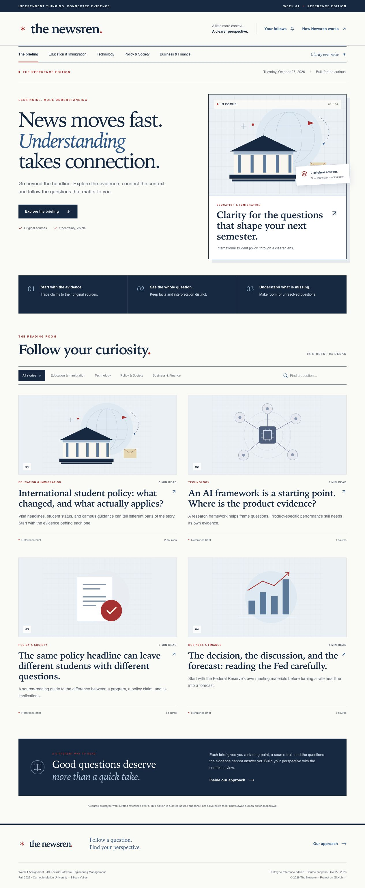

# The Newsren

The Newsren is an agentic news-intelligence prototype for understanding evolving, contested, and high-uncertainty stories. It helps readers separate verified facts from interpretation, compare credible perspectives, understand who is affected, and identify what to watch next.

> Week 1 Assignment for the course 49-772 A2 **Software Engineering Management, Fall 2026 offering at Carnegie Mellon University - Silicon Valley**.

The original product brief is preserved in [`docs/Newsren_Plan.pdf`](docs/Newsren_Plan.pdf).



## Live demo

[Open the production Newsren portal](https://newsren-agentic-news-portal.vercel.app)

The production project runs on Vercel's Hobby plan and automatically deploys
changes pushed to `main`. The dependable default demo requires no model API key
or paid runtime service.

## Product thesis

Newsren is not a generic news chatbot and does not try to produce a single authoritative opinion. It creates an evidence map around a developing question:

1. What is known?
2. What changed?
3. Where do credible sources disagree?
4. Who is affected?
5. What remains uncertain?
6. What should readers watch next?

The flagship prototype story focuses on changing United States rules and guidance affecting international students. This is a strong test case because policy announcements, agency guidance, court actions, university interpretation, and lived impact may change on different timelines.

## Initial desks

- **Education & Immigration** - student policy, university guidance, access, and learning evidence
- **Technology** - research, model releases, benchmarks, security, and regulation
- **Policy & Society** - evolving public policy with clearly separated facts, analysis, and opinion
- **Business & Finance** - company filings, earnings, industry implications, and regulation, with no investment advice

Sports is a sensible future desk for rule changes, governance, labor, safety, and disputed decisions. It is intentionally outside the first vertical slice so Week 1 remains focused and testable.

## Week 1 prototype

- Editorial homepage and four desks
- Four end-to-end evidence-grounded reference briefs
- AI Story Brief with claim-level sources
- A contextual **Ask Newsren** pane on the right side of story pages
- Student, educator, and professional explanation modes
- Local topic following with no account required
- Human-review status and finance guardrails
- Deterministic seeded content so the demo continues to work if an AI provider is unavailable

## Architecture

The UI is built with TypeScript, React, Vinext, Next.js, and Tailwind CSS. It
supports the original Cloudflare Worker/OpenAI Sites build and a native Next.js
deployment on Vercel. This is a weekly prototype, so the architecture
deliberately avoids model hosting and production-scale infrastructure:

- Seeded evidence bundles and reviewed outputs power the dependable public demo.
- A small inference adapter can call a free external API if one is configured.
- The locally installed Ollama `qwen3.5:9b` model is an optional development experiment, not a deployment requirement.

See [Architecture](docs/ARCHITECTURE.md), [Product Decisions](docs/PRODUCT_DECISIONS.md), [Editorial Navy design refresh](docs/DESIGN_REFRESH.md), and [Roadmap](docs/ROADMAP.md).

## Development

Prerequisites:

- Node.js 22.13 or newer
- npm
- Optional: Ollama with `qwen3.5:9b`

```bash
npm run install:ci
npm run dev
```

Phases 1 through 3 and the Phase 4 release candidate are implemented. No model or API key is required to run the prototype.

The current experience includes four reference briefs, desk filters, search, expandable evidence, source dates and provenance, an AI Story Brief, and the contextual Ask Newsren pane. Ask Newsren returns validated story-scoped answers with claim-level citations or explicitly abstains when evidence is missing. Student, educator, and professional modes reuse the same claim ledger. Readers can save one question per story locally and inspect explicitly simulated material-change events in the Your follows desk.

The local preview normally serves at `http://127.0.0.1:5173`. Stop it with Ctrl+C when finished; start it again with `npm run dev`. No background service is required while the project is idle.

Run `npm run evaluate` for the trust, usefulness, accessibility-structure, latency, and default-cost release gate. See the [evaluation report](docs/EVALUATION.md), [demo walkthrough](docs/DEMO_WALKTHROUGH.md), and phase handoffs for scope, limitations, and verification.

Use `npm run build` for the Vinext/Cloudflare target and `npm run build:vercel`
for the native Next.js/Vercel target.

## Editorial safety

- Every material claim must link to supporting evidence.
- Primary and authoritative sources are preferred.
- Reporting, analysis, and opinion are labeled separately.
- Credible disagreement is described instead of silently resolved.
- The system abstains when evidence is insufficient.
- Finance content is informational and never personalized investment advice.
- Initial publication requires human review.

## License

No open-source license has been granted. The repository is public for course review and demonstration.
