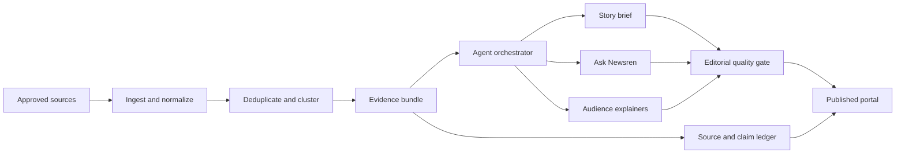

# Architecture

## Goals

- Keep browser-side computation light.
- Preserve an auditable chain from every claim to its sources.
- Demonstrate the editorial and agentic workflow without hosting a model.
- Keep the public demo fully usable without inference or API credentials.

## System shape

## Runtime

- **Web:** Vinext, React, TypeScript, and Tailwind CSS.
- **Hosting:** Cloudflare Worker deployment through OpenAI Sites.
- **Persistence:** browser storage for Week 1 follows; D1 when durable user data is introduced.
- **AI modes:** deterministic prototype agent by default; optional external API and Ollama adapters.
- **Retrieval:** approved feeds and first-party or authoritative pages only.

## Core domain objects

- `Source`: canonical URL, publisher, source type, publication time, retrieval time.
- `EvidenceItem`: excerpt or structured fact with provenance.
- `Claim`: statement, support status, confidence label, and linked evidence.
- `Story`: editorial framing, current status, desk, and update timestamp.
- `StoryEvent`: dated development in an evolving timeline.
- `Perspective`: attributed interpretation, never stored as an unqualified fact.
- `Follow`: a user-authored question and material-change criteria.

## Agent workflow

1. The orchestrator receives a bounded story question.
2. Discovery retrieves only approved source types.
3. Verification constructs an evidence bundle and identifies disagreement.
4. Synthesis creates a structured brief from that bundle.
5. The quality gate checks citations, unsupported language, and desk-specific rules.
6. A human approves high-impact content before publication.

## Failure behavior

- Missing provider: continue with the reviewed prototype responses.
- Provider timeout: preserve the user's question and offer evidence navigation.
- Insufficient support: answer with an explicit abstention and show what is missing.
- Conflicting sources: display the disagreement with attribution and dates.
- Stale story: show the last verified timestamp and block claims of currentness.
