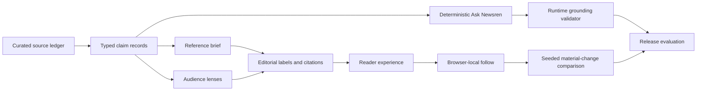

# Newsren demo and architecture walkthrough

## 90-second demo path

1. **Discover — homepage.** Start in the reading room and show the four editorial desks. Explain that these are curated reference briefs rather than a live feed.
2. **Understand — flagship brief.** Open International Student Policy. Point to the AI Story Brief, then expand one supported claim and one unresolved claim to show the evidence boundary.
3. **Investigate — Ask Newsren.** Ask “Summarize what is supported,” follow a citation to the source ledger, then ask “Does this affect my visa status today?” to demonstrate explicit abstention.
4. **Learn — audience modes.** Switch between Student, Educator, and Professional. Emphasize that the wording path changes while the underlying claim record and source state do not.
5. **Follow — local follow desk.** Save one bounded question, open Your follows, inspect the clearly labeled seeded simulation, and mark it reviewed. Refresh to show local persistence.
6. **Evaluate — release scorecard.** Finish on the five release gates and name the limitations: no live monitoring, no automated publishing, no account, and no model required.

Animated walkthrough: [Newsren Phase 4 demo](demo/newsren-phase-4-demo.gif).

## Architecture in one minute

- The deterministic engine is the default and costs no model tokens.
- An optional provider may select existing claim IDs but cannot write displayed factual prose.
- Follows remain in local storage; no server database or notification worker runs.
- Seeded updates are hypothetical simulations tied to existing affected claim IDs.
- The release harness fails when citation, completeness, accessibility structure, latency, or default-cost contracts fail.

## Suggested narration close

“Newsren is not trying to predict the truth from a pile of opinions. It makes the current evidence state inspectable: what is supported, what is interpretation, what remains unresolved, and what new evidence would be material. The Week 1 prototype demonstrates that complete loop without requiring a hosted model or production news infrastructure.”
