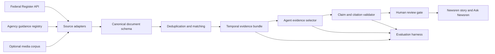

# Team project architecture and feasibility boundary

## Architectural objective

Extend the Week 1 curated prototype into a repeatable, auditable pipeline that can join regulatory records and authoritative guidance, retrieve related evidence, and construct a human-reviewable story bundle without hosting a model or depending on paid infrastructure.



## Components

| Component | Responsibility | Feasibility evidence |
| --- | --- | --- |
| Federal Register adapter | Retrieve structured rule and notice metadata without an API key | Live access succeeded on November 10, 2026 |
| Guidance registry adapter | Normalize curated government guidance into the same schema | Two existing State Department sources normalized |
| Canonical schema | Preserve ID, title, summary, URL, publisher, type, publication time and retrieval time | 100% required-field coverage in the six-record fixture |
| Matching layer | Identify candidate relationships across datasets | Keyword-overlap and TF-IDF/cosine experiments implemented |
| Evidence bundle | Keep source provenance, temporal boundaries and unresolved questions | Reuses the Week 1 source/claim ledger |
| Agent selector | Select existing evidence rather than authoring unchecked claims | Reuses deterministic and optional-provider boundary |
| Validator | Reject altered claims, unknown IDs and unsupported citations | Existing tests plus new feasibility tests |
| Human-review gate | Prevent automatic publication of high-impact policy claims | Existing review-state architecture; operational workflow remains future work |

## Canonical feasibility record

```text
id, dataset, title, summary, url, publishedAt, retrievedAt,
sourceType, publisher
```

The schema deliberately distinguishes `publishedAt` from `retrievedAt`. A missing publication date is preserved as missing instead of being replaced by the retrieval date.

## Trust boundary

The agent may rank or select evidence IDs. It may not silently create a new material claim. Displayed claims must either reproduce validated claim-ledger content with citations or be labeled unresolved. Currentness, individual immigration outcomes and legal advice remain outside the system's evidence boundary.

## Deployment boundary

- Vercel hosts the web application.
- The public demonstration works without an AI provider.
- Dataset snapshots are cached for reproducibility.
- Live ingestion is an explicit experiment, not a background crawler.
- Human review remains required before publishing policy conclusions.
